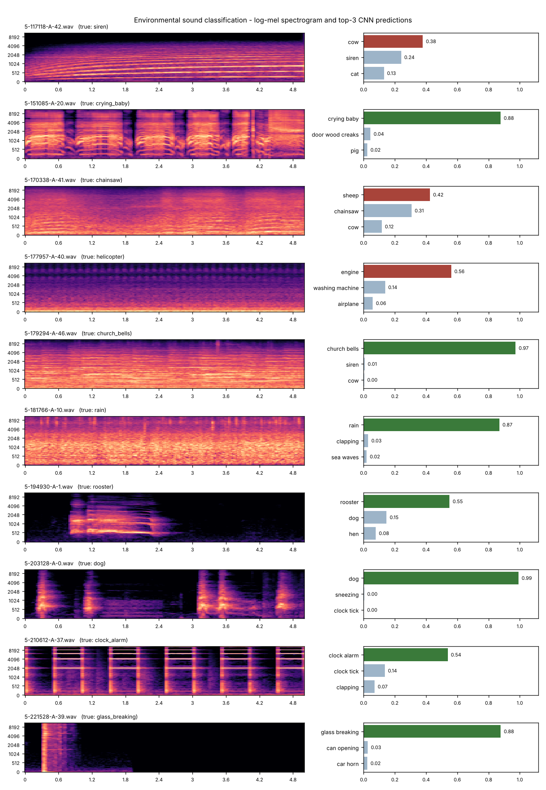

# Environmental Sound Classification using CNN

A convolutional neural network that recognises everyday sounds (dog bark, rain, siren, chainsaw, ...) from
5-second audio clips, trained from scratch on log-mel spectrograms of the **ESC-50** dataset (50 classes).

```
audio clip -> 22.05 kHz mono -> STFT -> 128 mel bands -> log dB -> 128 x 216 "image" -> CNN -> 50 class scores
```

## Quick demo

**1. Install [uv](https://docs.astral.sh/uv/) once** (it installs the right Python and all packages for you):

| OS | Command |
|---|---|
| Windows (PowerShell) | `powershell -ExecutionPolicy ByPass -c "irm https://astral.sh/uv/install.ps1 \| iex"` |
| Arch Linux | `sudo pacman -S uv` |
| Other Linux / macOS | `curl -LsSf https://astral.sh/uv/install.sh \| sh` |

**2. Clone and run the demo:**

```bash
git clone https://github.com/me-jain-anurag/environmental-sound-classification-cnn
cd environmental-sound-classification-cnn
uv run demo.py --show
```

The first run downloads Python 3.12 and TensorFlow (a few minutes); after that the demo takes a few seconds.
It classifies the ten unseen test clips in [`samples/`](samples/) with the trained model, prints a table and
opens `demo_output.png` (spectrogram and top-3 scores for each clip). No dataset download is needed.

```
   file                      true class        prediction (probability)          2nd / 3rd guess
--------------------------------------------------------------------------------------------------------
XX 5-117118-A-42.wav         siren             cow (0.38)                        siren / cat
OK 5-151085-A-20.wav         crying_baby       crying_baby (0.88)                door_wood_creaks / pig
XX 5-170338-A-41.wav         chainsaw          sheep (0.42)                      chainsaw / cow
XX 5-177957-A-40.wav         helicopter        engine (0.56)                     washing_machine / airplane
OK 5-179294-A-46.wav         church_bells      church_bells (0.97)               siren / cow
OK 5-181766-A-10.wav         rain              rain (0.87)                       clapping / sea_waves
OK 5-194930-A-1.wav          rooster           rooster (0.55)                    dog / hen
OK 5-203128-A-0.wav          dog               dog (0.99)                        sneezing / clock_tick
OK 5-210612-A-37.wav         clock_alarm       clock_alarm (0.54)                clock_tick / clapping
OK 5-221528-A-39.wav         glass_breaking    glass_breaking (0.88)             can_opening / car_horn
--------------------------------------------------------------------------------------------------------
7 of 10 clips classified correctly  (OK = correct, XX = wrong)
```



### Other things to try

| Command | What it does |
|---|---|
| `uv run demo.py my_recording.wav` | Classify your own audio (wav / flac / ogg / mp3, any length; longer files are scored in 5 s windows and averaged) |
| `uv run demo.py --full` | Download ESC-50 (~600 MB) and reproduce the full test-fold evaluation (67.0 %) |
| `uv run predict.py --demo 8` | Top-3 predictions for 8 random test-fold clips |
| `uv run train.py --out my_run` | Retrain from scratch into `runs/my_run/` (about 55 min on a laptop CPU; downloads the data if needed). Without `--out` it overwrites the provided model in `runs/esc50/` |
| `uv run train.py --subset esc10` | Train on the 10-class ESC-10 subset (about 12 min) |
| `uv run evaluate.py` | Metrics, confusion matrix and per-class accuracy plots in `runs/esc50/eval/` |
| `uv run --group notebook jupyter notebook notebooks/ESC50_CNN_Analysis.ipynb` | Open the analysis notebook (run `uv run demo.py --full` once first, it needs the dataset) |

<details><summary>Without uv</summary>

With Python 3.12 or 3.13: `pip install -r requirements.txt`, then `python demo.py`.
</details>

## Results

Evaluated on fold 5, which was never used for training or model selection (training: folds 1–3,
validation: fold 4).

| | ESC-50 (50 classes) | ESC-10 (10 classes) |
|---|---|---|
| Train / val / test clips | 1200 / 400 / 400 | 240 / 80 / 80 |
| Validation accuracy (fold 4) | 79.0 % | 95.0 % |
| **Test accuracy** | **67.0 %** | **90.0 %** |
| Top-3 test accuracy | 85.0 % | 97.5 % |
| Macro F1 | 0.646 | 0.898 |
| Training time (2-core CPU, no GPU) | 53.8 min | 11.5 min |

For reference, from the dataset authors: k-NN 32.2 %, SVM 39.6 %, random forest 44.3 %, Piczak's CNN
64.5 %, human listeners 81.3 %. Published numbers are 5-fold averages; ours is a single test fold
(95 % confidence interval about ±4.6 points).

Easiest classes: rain, thunderstorm, glass breaking, clock alarm, hand saw (100 %). Hardest: airplane and
helicopter (confused with each other and with engines), hen, water drops, clapping.

## How it works

| Stage | Details |
|---|---|
| Features | Resample to 22.05 kHz mono, STFT (2048-sample window, hop 512), 128 mel bands, log dB (80 dB range), scaled to [-1, 1] → 128 × 216 |
| Model | 4 blocks of Conv 3×3 → BatchNorm → ReLU → MaxPool (32/64/128/256 filters), one more Conv 3×3, global average pooling, Dense 256 + dropout, softmax (1,058,770 parameters) |
| Augmentation | Random time shift, SpecAugment (frequency and time masking), mixup, label smoothing 0.1 |
| Training | Adam (lr 0.001, halved on plateau), batch 32, early stopping on validation accuracy |

**Design note — dropout before batch normalisation.** The first version put dropout inside every conv block,
right before the next BatchNorm layer. Training accuracy rose but validation accuracy stayed near chance
(2–7 % after 10 epochs). The same checkpoint scored 33 % on training clips with live batch statistics but only
6 % with BatchNorm's stored running statistics: dropout shifts the activation variance between training and
inference (Li et al., CVPR 2019). Removing dropout from the conv blocks (keeping it in the dense head) and
using BN momentum 0.9 fixed it. The log of that run is in `runs/_experiment_dropout_before_bn/`.

## Project structure

```
demo.py                one-command demo (samples, your own files, or --full reproduction)
extract_features.py    cache log-mel spectrograms for all 2,000 clips (downloads ESC-50 if missing)
train.py               train on folds 1-3, validate on fold 4, test on fold 5
evaluate.py            metrics, confusion matrix, per-class accuracy, learning curves
predict.py             top-3 predictions for any audio files
esc_cnn/               config, feature extraction, data pipeline + augmentation, model, inference, download
notebooks/             executed analysis notebook
runs/esc50, runs/esc10 trained models, class lists, training history, logs and evaluation plots
samples/               ten test-fold clips for the demo (with attribution)
docs/demo.png          the picture produced by the demo (shown above)
pyproject.toml, uv.lock, .python-version   exact environment used to produce the results
```

## Dataset and licence

ESC-50 by K. J. Piczak (ACM Multimedia 2015), https://github.com/karolpiczak/ESC-50, released under
Creative Commons Attribution-NonCommercial. The full dataset is downloaded on demand into `data/` and is not
part of this repository; the ten clips in `samples/` are redistributed with attribution
(see [`samples/README.md`](samples/README.md)).
